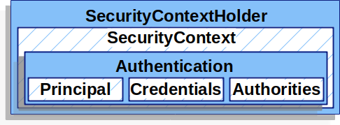
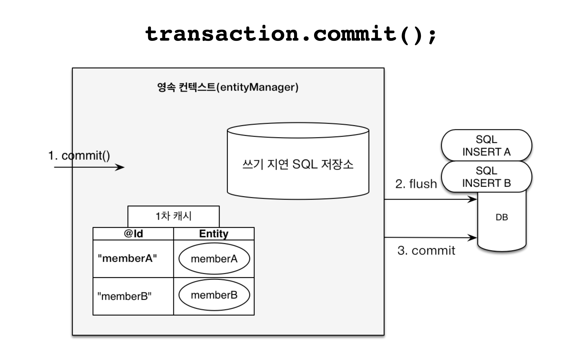
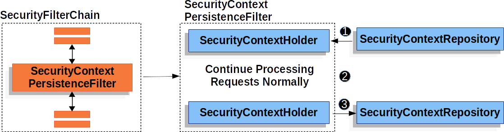
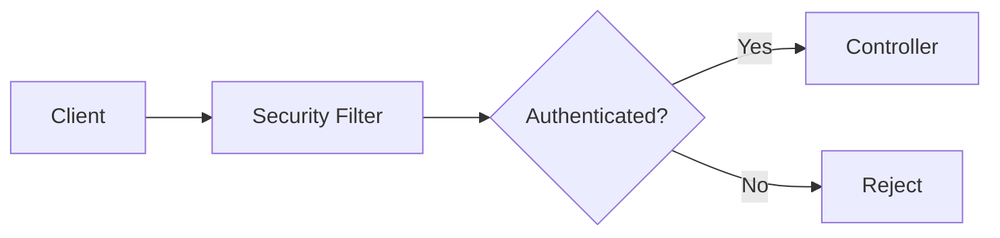

> [!IMPORTANT]
> 이 문서는 **임시 UI 점검용 글**입니다. 아래 이미지는 기존 게시글에 들어 있는 파일을 재사용하며, 새로운 기술적 주장을 검증하거나 발행하기 위한 내용이 아닙니다.

## 1. 일반 이미지의 크기와 캡션

첫 번째 이미지는 기본 이미지입니다. 데스크톱에서는 본문 폭을 무조건 가득 채우지 않고 적당한 최대 너비로 표시되는지, 화면이 좁아졌을 때는 비율을 유지하며 축소되는지 살펴봅니다. 클릭과 `Enter` 키로 라이트박스를 열고 닫는 동작도 테스트할 수 있습니다.



### 1.1 원본 색상 유지와 확대 제외

아래 이미지는 `{no-dark-filter}` 옵션을 적용해 다크 모드에서도 원본 색상이 변하지 않도록 합니다. 동시에 `{no-lightbox}`를 적용해 클릭할 수 있는 이미지와 클릭하지 않는 이미지를 구분합니다.



## 2. 명시적인 전체 너비 이미지

일반 이미지와 달리 아래 이미지는 `{full-width}`를 사용했습니다. 가로로 긴 이미지일 때 본문의 가용 폭을 사용하는지 확인할 수 있습니다. 실제 이미지의 너비가 작더라도 전체 너비 지시가 우선되는지 여부도 테스트 대상입니다.



> [!NOTE]
> 이미지가 흐리게 보인다면 원본 파일의 해상도 문제인지, CSS로 강제로 확대되어 발생한 현상인지 구분해야 합니다. 라이트박스를 열었을 때 별도 배경, 원본 비율, 닫기 버튼의 초점 이동도 확인합니다.

## 3. 렌더링되는 구조도와 코드 스타일의 차이

여기서는 Mermaid 구조도를 배치합니다. 외부 렌더링 스크립트가 로드되지 않을 때는 원문 코드가 남아 있어야 하고, 정상 로드될 때는 라이트/다크 테마에 맞는 읽기 쉬운 다이어그램으로 표시되어야 합니다.



### 3.1 파일 구조형 컴포넌트

```learn-tree
src/
  components/
    post/
      PostToc.astro
      PostCodeEnhancer.astro
  content/
    blog/
      ui-preview/
        03-media-learning-components.md
```

### 3.2 단계 안내형 컴포넌트

```learn-steps
[
  "라이트 모드에서 본문과 이미지 여백을 확인합니다.",
  "다크 모드에서 코드 블록, 도식, 링크의 대비를 확인합니다.",
  "모바일에서 본문 가로 넘침과 탭 조작성을 확인합니다."
]
```

## 4. 학습용 탭과 수식

다음 탭은 문서의 내용보다 **탭 레이블의 위치, 선택 상태, 키보드 화살표 이동, 탭 패널의 배경과 높이 변화**를 확인하기 위한 예시입니다.

```learn-tabs
[
  {"title":"읽기 관점","text":"긴 문단의 폭, 줄 높이, 소제목의 위아래 간격을 확인합니다."},
  {"title":"코드 관점","text":"코드 블록의 언어 표시와 복사 버튼, 구문 강조 대비를 확인합니다."},
  {"title":"모바일 관점","text":"본문 이미지의 반응형 폭과 표의 가로 스크롤을 함께 확인합니다."}
]
```

짧은 인라인 수식 `math:T(n) = O(n \log n)`과 다음 블록 수식의 폰트 크기, 줄 간격, 다크 배경에서의 선명도를 비교할 수 있습니다.

```math
T(n) = O(n \log n)
```

### 4.1 접을 수 있는 긴 설명

<details>
<summary>상세 설명 펼치기</summary>

이 부분은 펼치기 전후의 카드 높이 변화와 키보드 탐색을 확인하기 위한 설명입니다. 다른 섹션의 위치가 튀거나 목차가 엉뚱한 항목을 선택하지 않아야 합니다.

</details>

## 5. 정리

- 일반 이미지는 원본 비율과 최대 너비를 유지하며 과도하게 확대되지 않아야 합니다.
- 명시적인 전체 너비 이미지는 본문 가용 폭을 쓰되 모바일 가로 넘침을 만들지 않아야 합니다.
- 라이트박스, Mermaid, 탭, 단계 안내와 파일 트리는 다크 모드에서도 가독성과 조작성을 유지해야 합니다.
- 수식과 접기 요소는 기본 Markdown 본문과 다른 시각적 계층을 만들더라도 과도하게 강조되지 않아야 합니다.

## 6. 참고 자료

- [기존 Spring Security 인증과 인가 글](/blog/security/basic1/)
- [기존 JPA 영속성 컨텍스트 글](/blog/jpa/persistence-context/)
